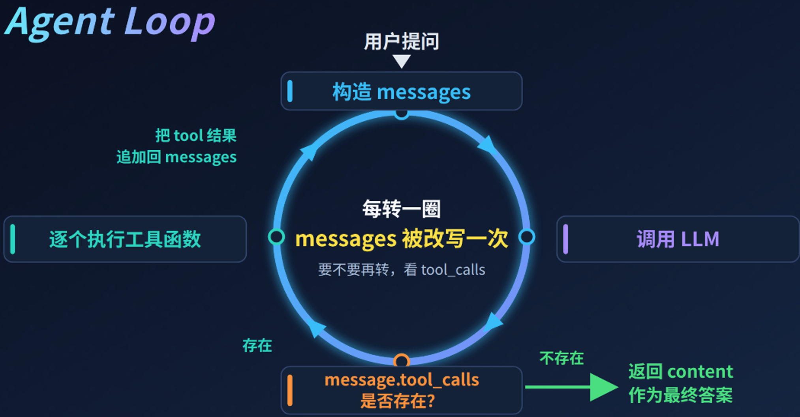
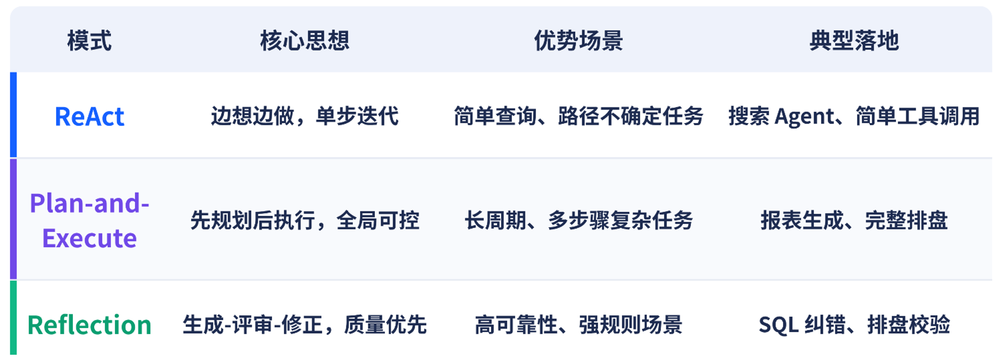

## Agent Loop

### 一、Agent Loop 是什么

Agent Loop 是 `思考→行动→观察→再思考` 的循环机制，这个闭环会不断循环，直到任务完成或触发终止条件

| 阶段               | 人话                                 | 代码对象                                         | 对应 LangGraph                                                            |
|------------------|------------------------------------|----------------------------------------------|-------------------------------------------------------------------------|
| **思考** Reasoning  | LLM根据当前消息、工具结果和任务进度推理，决定下一步做什么     | `state["messages"]` 和 `reasoning_content`    | `llm` 节点                                                                |
| **行动** Action     | 判断有无 `tool_calls`，有就调用调工具，没有就给出最终答案 | `AIMessage.tool_calls` / `AIMessage.content` | 条件边 `add_conditional_edges("llm", tools_condition)`-> `tools` 节点 / `END` |
| **观察** Observation  | 执行工具并把结果写回会话历史                     | `ToolNode` → `ToolMessage` 追加                | tools 节点（由 `ToolNode` 构造）+ `add_edge("tools", "llm")` 回边                    |

实际上就是 ReAct 的具体体现，ReAct 论文：https://arxiv.org/pdf/2210.03629

### 二、经典 Agent Loop 模式

| 模式       | 英文术语                 | 核心逻辑  | 适用场景 |
|:---------|:---------------------| :--- | :--- |
| **实时决策** | **ReAct**            | **思考 → 行动 → 观察**   边想边做，走一步看一步 | 单任务、信息探索、简单问答（如：查询天气、搜资料、简单计算） |
| **策略蓝图** | **Plan-and-Execute** | **规划 → 拆解 → 执行 → 整合**   先画图纸，再按部就班施工 | 多步骤长链路任务、复杂工程（如：写一份行业研究报告、开发完整代码、制定旅游计划） |
| **修正偏差** | **Self-Reflection**  | **生成 → 评估 → 修正**   自我纠错，直到满意为止  | 高准确率要求、代码审查、创意写作、翻译、逻辑推理题 |

在实际的 Agent 系统设计中，这三种模式往往不是孤立存在的，而是可以**组合使用**：
- **简单查询**：直接用 ReAct。
- **复杂项目**：外层用 Plan-and-Execute 拆解任务，内层每个子任务用 ReAct 执行。
- **关键环节**：在 Plan-and-Execute 的“整合”阶段，或者 ReAct 的最终答案输出阶段，嵌入 Reflection 模块进行自我审查，确保万无一失

认知框架总结

### 三、为什么会陷入无线循环

### 四、如何避免无限循环
防止无限循环需采用“模型主动终止 + 最大步数兜底 + 重复检测 + 超时与Token熔断”的多层防御策略

### 五、Agent Loop 练习题
#### 题目 1：Agent Loop 的终止判断（情境扩展）

某 Agent 使用 `agent.stream()` 运行，历史 `messages` 中已经出现过多次 `tool_calls`。当前这一轮模型返回的 assistant 消息中**没有** `tool_calls`，只有普通 `content`。按照课件中的 Agent Loop 机制，系统最合理的处理是：

A. 因为历史消息中出现过 `tool_calls`，所以继续循环调用工具
B. 检查当前轮 assistant 消息是否含 `tool_calls`；若没有，则将 `content` 作为最终答案
C. 只要 `event["tools"]` 曾经出现过，就必须继续循环
D. 必须等到 `step_count` 达到固定上限后才允许输出答案

**答案：B**

**解析：** Agent Loop 是否继续转，关键看当前轮模型输出是否还存在 `tool_calls`。历史 `tool_calls` 只是执行轨迹，不代表当前还要继续调用工具。若当前轮无 `tool_calls`，即可认为模型已有足够信息，返回 `content` 作为最终答案。扩展来看，工程中通常还会设置最大轮数、超时等安全终止条件，但它们不是课件中的主判断逻辑。

------

#### 题目 2：模式组合选择（场景扩展）

你要构建一个“季度经营分析报告 Agent”。任务整体步骤比较清晰：拉取数据 → 计算指标 → 生成图表 → 撰写结论。但在“异常指标归因”这一子步骤中，需要根据中间结果反复查询不同维度的数据，动态决定下一步查什么。最合理的架构是：

A. 全部使用 ReAct，每一步都边想边查
B. 全部使用 Plan-and-Execute，开始一次性规划后不再调整
C. 以 Plan-and-Execute 组织整体流程，在“异常指标归因”子步骤中嵌入 ReAct 做动态决策
D. 只使用 Self-Reflection，通过多轮自我审查替代工具调用

**答案：C**

**解析：** 该任务整体步骤明确，适合用 Plan-and-Execute 提高效率和稳定性；但异常归因需要根据观察结果动态调整查询路径，适合在子步骤中嵌入 ReAct。课件中也提到“Plan-and-Execute 为主、ReAct 为辅”的组合策略：用约束换整体效率，用灵活换局部应变能力。

------

#### 题目 3：Reflection 的局限与改进（扩展思考）

在 Self-Reflection 模式中，Agent 先生成答案，再对答案进行审查和修正。但实际工程中可能出现“评审模型总是认可自己的初稿”的问题，导致反思流于形式。以下哪种改进最有效？

A. 让同一个模型用更高的 temperature 多反思几轮
B. 删除反思阶段，直接输出初稿，减少开销
C. 引入外部规则校验、工具验证或独立评审模型，并设置明确的通过标准
D. 把所有任务都改成 ReAct，不再需要反思

**答案：C**

**解析：** Self-Reflection 的效果高度依赖“评审质量”。如果评审者和生成者是同一模型且缺乏外部依据，容易产生自我确认偏差。更有效的做法是引入外部验证，例如规则检查、工具返回结果校验、独立评审模型或明确评分标准。A 只是增加随机性，未必提高审查质量；B、D 则回避了问题，而不是改进反思机制
