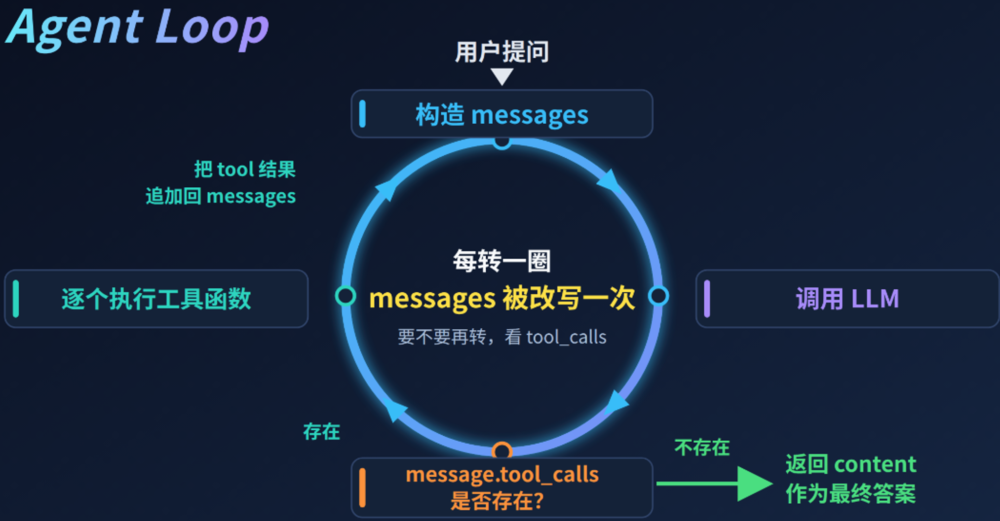

## Agent Loop

### 一、Agent Loop 是什么

Agent Loop 是 `思考→行动→观察→再思考` 的循环机制，这个闭环会不断循环，直到任务完成或触发终止条件

| 阶段               | 人话                              | 代码对象                                         | 对应 LangGraph                                                            |
|------------------|---------------------------------|----------------------------------------------|-------------------------------------------------------------------------|
| **思考** Reasoning  | LLM根据当前状态推理，决定下一步做什么            | `state["messages"]` 和 `reasoning_content`    | `llm` 节点                                                                |
| **行动** Action     | 判断有无 `tool_calls`，要么调工具，要么给最终答案 | `AIMessage.tool_calls` / `AIMessage.content` | 条件边 `add_conditional_edges("llm", tools_condition)`-> `tools` 节点 / `END` |
| **观察** Observation  | 执行工具并更新会话历史                | `ToolNode` → `ToolMessage` 追加                | tools 节点（由 `ToolNode` 构造）+ `add_edge("tools", "llm")` 回边                    |

实际上就是 ReAct 的具体体现，ReAct 论文：https://arxiv.org/pdf/2210.03629

### 二、经典 Agent Loop 模式

| 模式 | 英文术语 | 核心逻辑 | 比喻 | 适用场景 |
| :--- | :--- | :--- | :--- | :--- |
| **实时决策** | **ReAct** | **思考 → 行动 → 观察**   边想边做，走一步看一步 | 像一个“敏捷的探险家”，发现障碍就绕过去，不需要提前画好完整地图 | 单任务、信息探索、简单问答（如：查询天气、搜资料、简单计算） |
| **策略蓝图** | **Plan-and-Execute** | **规划 → 拆解 → 执行 → 整合**   先画图纸，再按部就班施工 | 像一个“项目经理”，先把大目标拆解成10个子任务，再分配下去执行 | 多步骤长链路任务、复杂工程（如：写一份行业研究报告、开发完整代码、制定旅游计划） |
| **修整偏差** | **Reflection** | **生成 → 评估 → 修正**   自我纠错，直到满意为止 | 像一个“严谨的编辑”，写完初稿后反复修改润色，确保没有逻辑漏洞 | 高准确率要求、代码审查、创意写作、翻译、逻辑推理题 |

在实际的 Agent 系统设计中，这三种模式往往不是孤立存在的，而是可以**组合使用**：
- **简单查询**：直接用 ReAct。
- **复杂项目**：外层用 Plan-and-Execute 拆解任务，内层每个子任务用 ReAct 执行。
- **关键环节**：在 Plan-and-Execute 的“整合”阶段，或者 ReAct 的最终答案输出阶段，嵌入 Reflection 模块进行自我审查，确保万无一失

### 三、为什么会陷入无线循环

### 三、如何避免无限循环
防止无限循环需采用“模型主动终止 + 最大步数兜底 + 重复检测 + 超时与Token熔断”的多层防御策略
