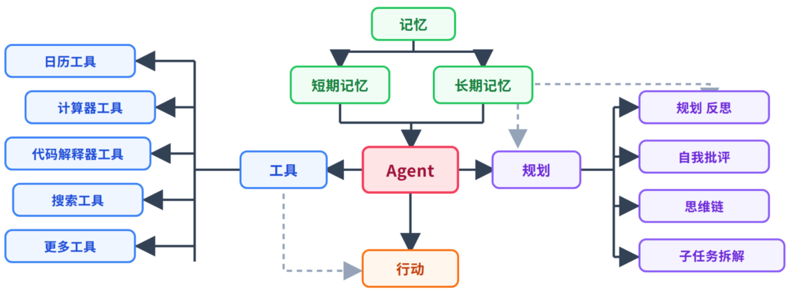
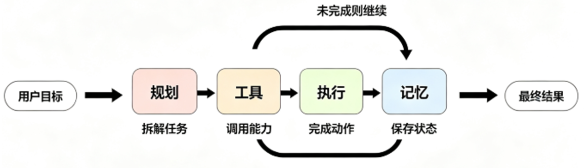
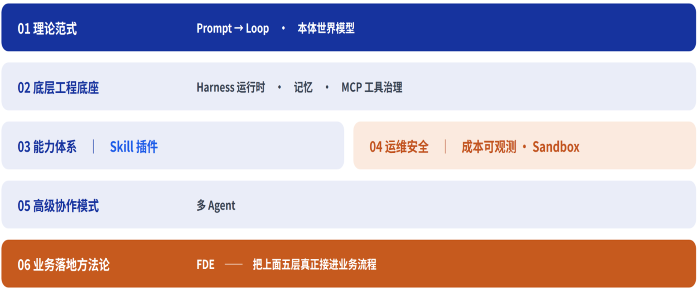

## Agent入门

### 一、Agent的定义和组成
Agent 是以大语言模型为推理核心，围绕一个目标自主规划步骤、调用工具、读写记忆，并根据环境反馈循环迭代，直到任务完成的系统

Agent = 大模型思考能力 + 规划能力 + 工具调用 + 迭代执行 + 记忆能力
- **规划**：将模糊、复杂的任务，拆解成逻辑清晰，可被执行的多个子任务
- **工具**：调用外部工具，如：调用API、执行代码、访问网络等，技术实现：Function Calling
- **记忆**：赋予Agent记忆能力，分短期记忆和长期记忆

### 二、企业级 Agent 架构方法论

### 三、Agent 的范式演进
- L1 Prompt Engineering（2022–2024）：指令层，控制模型输出什么
- L2 Context Engineering（2024–2025）：信息层，控制模型看见什么  
- L3 Harness Engineering（2025 末–2026 初）：运行时层，控制模型能做什么、约束行为边界
- L4 Loop Engineering（2026 至今）：自主闭环层，让 Agent 自我迭代、自主完成长周期任务
- L5 Graph Engineering（图工程）: 2026 年主流多 Agent 终极范式

### 四、Function Calling 原理
- **作用**：赋予大模型调用外部工具或外部API的能力
- **参考**：https://api-docs.deepseek.com/zh-cn/guides/tool_calls
- **流程**：
  - ① 将用户提问和函数说明一起发给大模型
  - ② 大模型返回具体调用函数和参数
  - ③ 然后调用函数并将函数运行结果再发给大模型
  - ④ 大模型在基于函数运行结果进行回答

