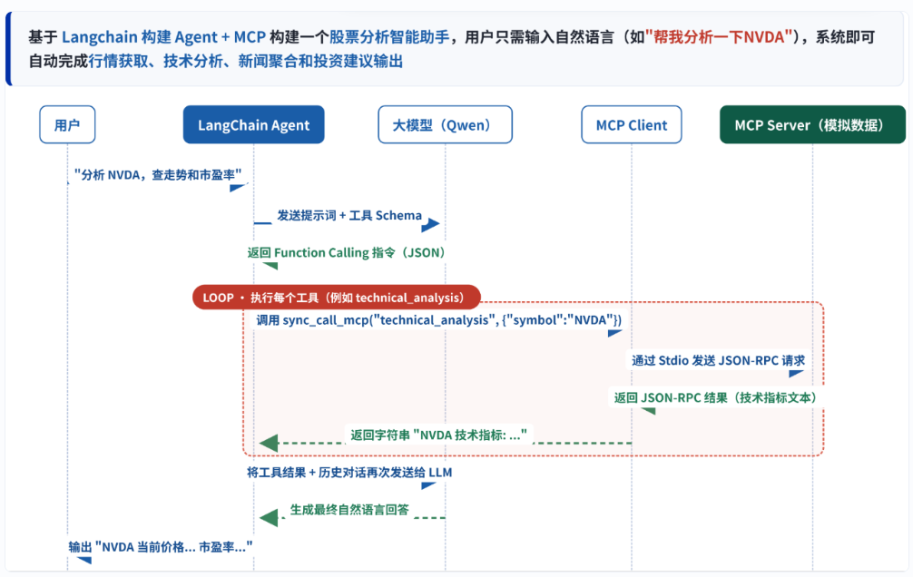

## 一、`@mcp.tool()` 详解
@mcp.tool() 装饰器自动做四件事：
- 从函数名 `fetch_stock` 生成工具名；
- 从 `docstring` 生成工具描述（这里就是"获取指定股票…最近5天的OHLCV行情数据。"这句）；
- 从 `Annotated[str, Field(description=...)]` 生成 `inputSchema`；
- 返回的 `str 自动包装成 [types.TextContent(type="text", text=...)]`，你只管 `return` 字符串。

## 二、股票分析助手时序图

## 三、相关题目
### 1. MCP Client 与 MCP Server 的通信方式中，适用于“远程部署、多客户端随时连接和断开”的是？

A. Stdio
B. HTTP+SSE
C. FTP
D. SMTP

**答案：B**
**解析：** PPT 第 21 页指出，Stdio 适用于本地快速集成测试；HTTP+SSE 适用于远程部署 / 多客户端场景，Server 可作为独立进程运行，支持多个客户端连接和断开。

------

### 2. 与 Function Calling 相比，MCP 协议在“状态管理”方面的主要特点是？

A. 无状态、无会话
B. 完整会话生命周期、上下文持久化
C. 只支持单轮函数调用
D. 只负责业务任务状态流转

**答案：B**
**解析：** PPT 第 9 页对比表显示：Function Calling 是无状态、无会话；MCP 协议具备完整会话生命周期、上下文持久化；AI Agent 侧重业务任务状态流转。

------

### 3. 企业落地 MCP 的“准入三问”不包括以下哪一项？

A. 谁维护这个 Server？
B. 它到底能做什么？
C. 出事了能不能一分钟切断？
D. 是否已经接入所有社区 MCP Server？

**答案：D**
**解析：** PPT 第 16—17 页指出，准入三问是：谁维护这个 Server、它到底能做什么、出事了能不能一分钟切断。重点不是“接入所有社区 Server”，而是来源可信、能力清楚、可快速切断。

------

### 4. 在 A2A 协议中，用于描述智能体身份与能力声明的核心概念是？

A. Task
B. Agent Card
C. Transport
D. MCP Server

**答案：B**
**解析：** PPT 第 27 页指出，Agent Card 是智能体的“名片”，用于声明身份与能力；Task 是协作基本单元；Transport 是网络通信实现。

------

### 5. 在“股票分析智能助手”案例中，MCP Client 通过 Stdio 向 MCP Server 发送的请求格式是？

A. HTTP 表单
B. JSON-RPC
C. XML
D. SQL

**答案：B**
**解析：** PPT 第 23 页流程图显示，MCP Client 通过 Stdio 发送 JSON-RPC 请求，MCP Server 返回 JSON-RPC 结果。
