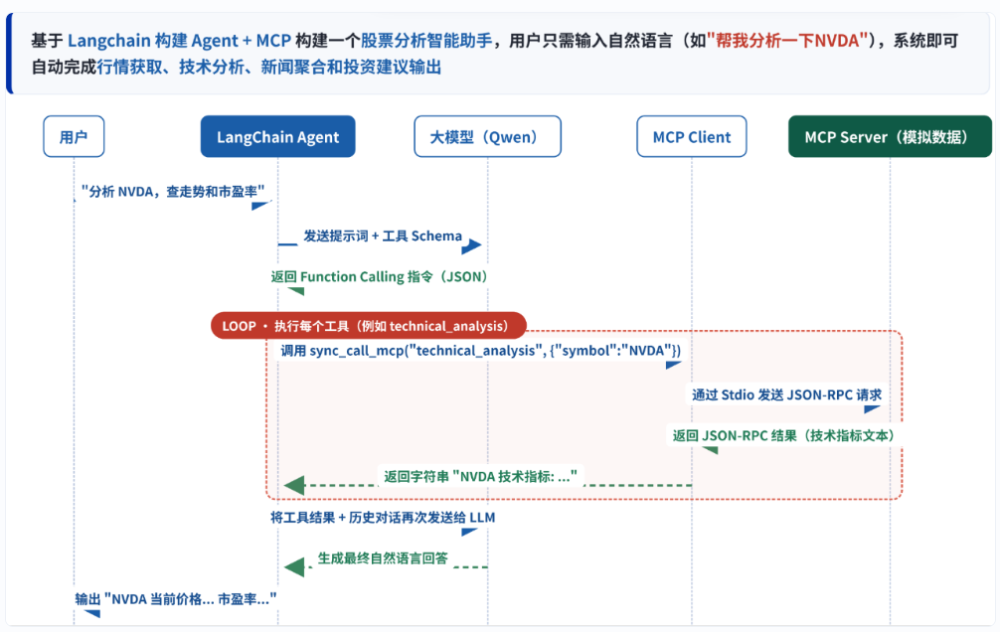

@mcp.tool() 装饰器自动做四件事：
- 从函数名 `fetch_stock` 生成工具名；
- 从 `docstring` 生成工具描述（这里就是"获取指定股票…最近5天的OHLCV行情数据。"这句）；
- 从 `Annotated[str, Field(description=...)]` 生成 `inputSchema`；
- 返回的 `str 自动包装成 [types.TextContent(type="text", text=...)]`，你只管 `return` 字符串。

