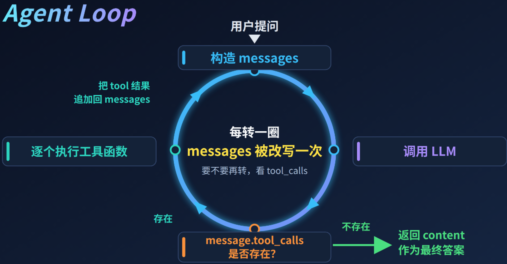

## Agent Loop

### 一、Agent Loop 是什么

Agent Loop 是 `思考→行动→观察→再思考` 的循环机制，这个闭环会不断循环，直到任务完成或触发终止条件


| 阶段               | 人话                              | 代码对象                                             | 对应 LangGraph                                                            |
|------------------|---------------------------------|--------------------------------------------------|-------------------------------------------------------------------------|
| **思考** Thinking  | LLM根据当前状态推理，决定下一步做什么            | `state["messages"]` 和 `reasoning` content block） | `llm` 节点                                                                |
| **行动** Acting    | 判断有无 `tool_calls`，要么调工具，要么给最终答案 | `AIMessage.tool_calls` / `AIMessage.content`     | 条件边 `add_conditional_edges("llm", tools_condition)`-> `tools` 节点 / `END` |
| **观察** Observing | 执行工具并更新会话历史                | `ToolNode` → `ToolMessage` 追加           | tools 节点（由 `ToolNode` 构造）+ `add_edge("tools", "llm")` 回边                    |



#### LangChain（create_agent）
```python
from langchain.chat_models import init_chat_model
from langchain.tools import tool
from langchain_core.messages import HumanMessage
from langgraph.prebuilt import create_agent  # <---- 引入 create_agent

# ====== Step 1: 准备工具 ======
@tool
def get_weather(city: str) -> str:
    """获取城市天气"""
    weather_data = {
        "北京": "晴天 25度",
        "上海": "多云 28度",
        "杭州": "小雨 22度",
    }
    return weather_data.get(city, f"未找到{city}的天气信息")

# 组成工具数组
tools = [get_weather]

# ====== Step 2: 准备模型 ======
# 定义模型 (注意：create_agent 内部会自动处理 bind_tools，所以这里不需要手动绑定)
model = init_chat_model(
    'deepseek-v4-flash',
    extra_body={'thinking': {'type': 'disabled'}}
)

# ====== Step 3: 使用 create_agent 构建图 ======
# create_agent 会自动创建一个包含 LLM 节点和 ToolNode 的图，并处理好它们之间的循环逻辑
agent_graph = create_agent(model=model, tools=tools)

# ====== Step 4: 调用 ======
result = agent_graph.invoke({
    "messages": [HumanMessage(content="北京和杭州今天天气怎么样？")]
})

for m in result['messages']:
    m.pretty_print()
```

#### LangGraph
```python
from langchain.chat_models import init_chat_model
from langchain.tools import tool
from langchain_core.messages import HumanMessage
from langgraph.constants import START, END
from langgraph.graph import StateGraph, MessagesState
from langgraph.prebuilt import ToolNode, tools_condition


# ====== Step 1: 准备工具 ======
@tool
def get_weather(city: str) -> str:
    """获取城市天气"""
    weather_data = {
        "北京": "晴天 25度",
        "上海": "多云 28度",
        "杭州": "小雨 22度",
    }
    return weather_data.get(city, f"未找到{city}的天气信息")

# 组成工具数组
tools = [get_weather]

# ====== Step 2: 准备模型，绑定工具 ======
# 定义模型
model = init_chat_model(
    'deepseek-v4-flash',
    extra_body = {'thinking': {'type': 'disabled'}}
)
# 绑定工具到模型，与create_agent类似，将来LangChain会自动帮我们拼接tool信息发给模型
model_with_tools = model.bind_tools(tools)


# ====== Step 3: 定义Node ======
def llm_node(state: MessagesState):
    """LLM节点：调用模型，可以选择调用工具"""
    response = model_with_tools.invoke(state["messages"])
    return {"messages": [response]}

# ====== Step 4: 构建图 ======
builder = StateGraph(MessagesState)
# Node
builder.add_node("llm", llm_node)
builder.add_node("tools", ToolNode(tools))                               # <----
# Edge
builder.add_edge(START, "llm")
builder.add_conditional_edges("llm", tools_condition)                    # <----
builder.add_edge("tools", "llm")  # 工具执行后回到LLM，形成循环             # <----
agent_graph = builder.compile()

# ====== Step 5: 调用 ======
result = agent_graph.invoke({
    "messages": [HumanMessage(content="北京和杭州今天天气怎么样？")]
})
for m in result['messages']:
    m.pretty_print()
```

### 二、经典 Agent Loop 模式


### 三、为什么会陷入无线循环

### 三、如何避免无限循环
防止无限循环需采用“模型主动终止 + 最大步数兜底 + 重复检测 + 超时与Token熔断”的多层防御策略
