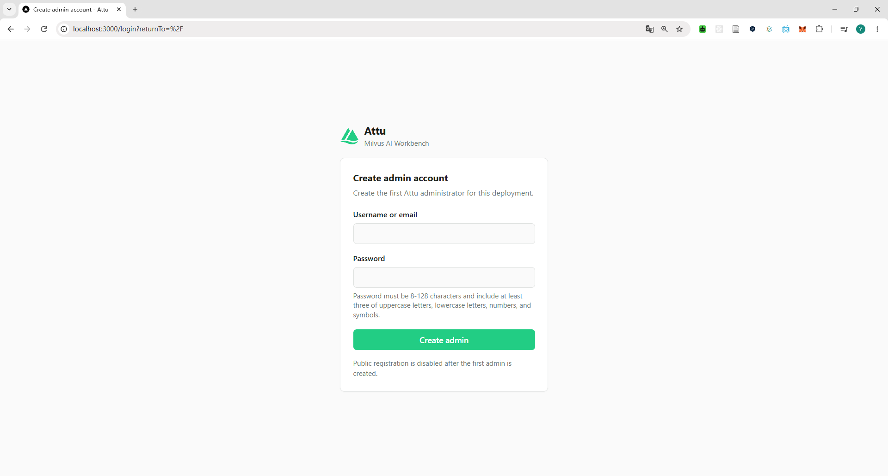
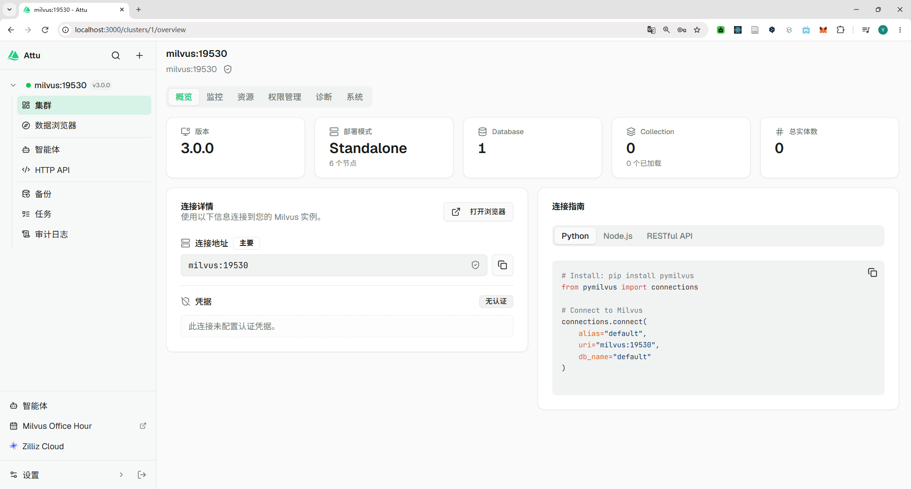
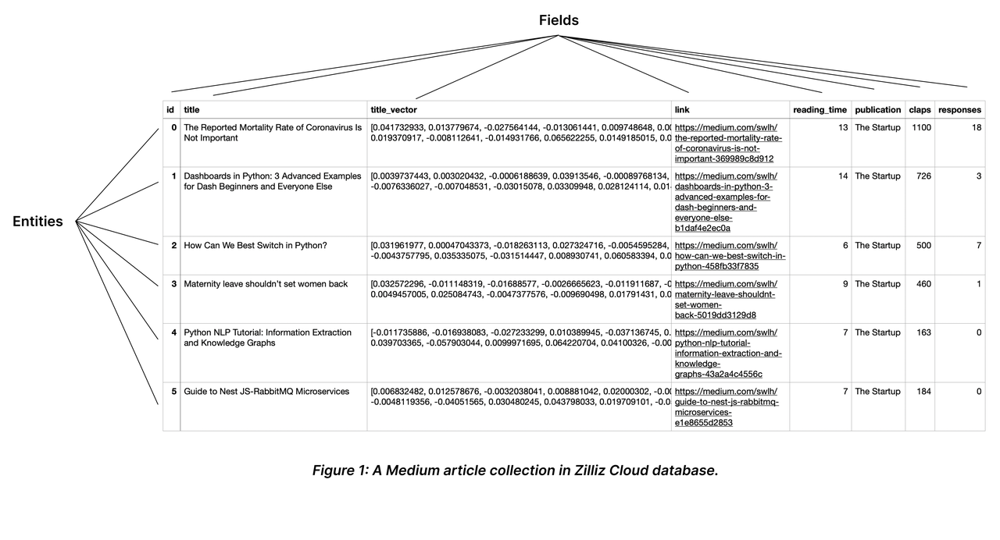
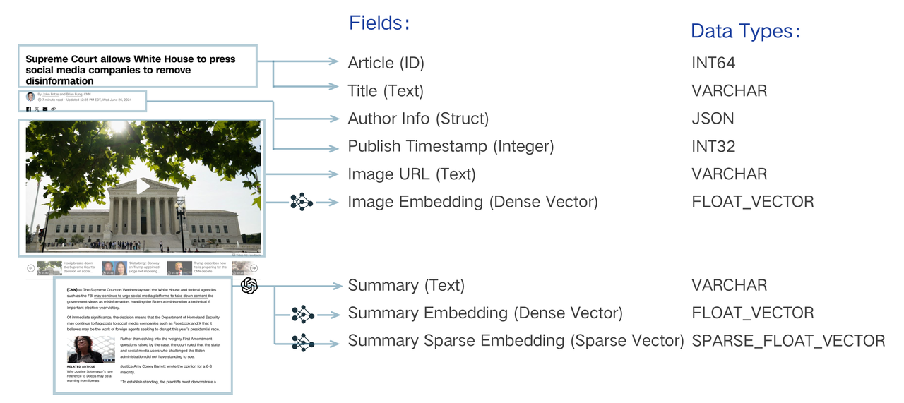

## Milvus

### 一、Milvus 概述
Milvus 由 Zilliz 开发，并即将捐赠给 Linux 基金会旗下的 LF AI & Data Foundation，现已成为全球领先的开源向量数据库项目之一。 该项目采用 Apache 2.0 许可证发布，大多数贡献者来自高性能计算（HPC）领域的专家，他们专长于构建大规模系统和优化硬件感知代码。核心贡献者包括来自 Zilliz、ARM、NVIDIA、AMD、Intel、Meta、IBM、Salesforce、阿里巴巴和微软的专业人士。

有趣的是，Zilliz 的每个开源项目都以鸟类命名，这一命名惯例象征着自由、远见以及技术的敏捷演进。Milvus是鹰科，鸢属的一种猛禽，以其飞行速度快、视力敏锐和非凡的适应能力而著称。


Milvus 提供三种部署模式，覆盖广泛的数据规模——从 Jupyter Notebook 中的本地原型设计，到管理数百亿向量的大型 Kubernetes 集群：

- `Milvus Lite` 是一个 Python 库，可轻松集成到您的应用程序中。作为 Milvus 的轻量级版本，它非常适合在 Jupyter Notebook 中进行快速原型设计，或在资源有限的边缘设备上运行。
- `Milvus Standalone` 是一种单服务器部署方案，所有组件打包到单个 Docker 镜像中，便于部署。了解更多。
- `Milvus Distributed` 可部署在 Kubernetes 集群上，采用专为数十亿量级甚至更大规模场景设计的云原生架构。该架构确保了关键组件的冗余性。


### 二、Milvus 安装部署
本地开发建议使用 `Milvus Standalone` 模式，由于Milvus依赖一些其它服务，因此部署时不仅需要Milvus，还要把依赖服务一起部署。这就需要用到DockerCompose了
使用 `docker compose` 命令即可一键部署：
```
# /deploy/docker-compose.yml
docker compose up -d
```

Milvus有一个web控制台叫attu，端口是3000，在浏览器输入地址：http://locahost:3000 即可访问：


首次访问，需要注册一个管理员的用户名和密码，密码必须8位以上，且必须有大写、小写、数字、下划线中的3个类型。例如：admin/admin_123

注册成功并登录后，可以看到Milvus信息：



### 三、Milvus 基础概念
#### 1. Collection、Field、Entity

|Milvus|MySQL|含义|
|---|---|---|
|Collection|Table|一组结构相同的数据集合|
|Field|Column|描述数据的某个属性，例如标题、文本、向量|
|Entity|Row|Collection 中的一条完整数据|

下图展示了一个包含 8 个 Field 和 6 个 Entity 的 Collection：



#### 2. Schema
**Schema** 用来定义 Collection 中包含哪些 Field，以及每个 Field 的名称、数据类型和相关属性

常见的 Schema 属性可以按使用场景分为以下几类：

| 适用场景          |属性|说明|
|---------------|---|---|
| 通用            |`field_name`|字段名称|
|               |`datatype`|字段的数据类型|
|               |`description`|字段说明|
| 主键            |`is_primary`|是否为主键|
|               |`auto_id`|是否由 Milvus 自动生成主键|
| 字符串 `VARCHAR` |`max_length`|字符串字段的最大长度|
| 向量            |`dim`|向量的维度|
| 数组   `ARRAY`  |`element_type`|数组中元素的数据类型|
|               |`max_capacity`|数组最多可以保存的元素数量|

在实际开发中，我们要根据文档的数据特点来选择合适的字段类型，例如官网给出的示例：



#### 3. Index


`Index`，也就是索引，用来提高数据检索速度。根据字段的数据类型不同，Milvus 中常用的索引可以分为三类：

| 数据类型 | 保存的内容   | 常见索引 | 用途 |
| :---|:--------| :--- | :--- |
| 稠密向量 | 文本的语义特征 | `AUTOINDEX`、`HNSW`、`IVF_FLAT` | 加速向量相似度检索 |
| 稀疏向量 | 关键词及其权重 | `SPARSE_INVERTED_INDEX` | 加速稀疏向量检索 |
| 标量字段（普通字段）| 名称、分类、状态等业务数据        | `INVERTED`、`BITMAP` | 条件过滤，缩减向量检索范围 |

实际检索时，三类索引可以配合使用：
- 先用普通字段索引过滤数据，缩小数据检索范围，
- 再用稠密向量索引匹配语义，稀疏向量索引匹配关键词。

稠密向量和稀疏向量不是替代关系，而是互补关系，实际中经常会同时使用两种检索方式，也就是混合检索。

> ⚡ 说明：
> - 在Milvus中内置了BM25的稀疏向量实现，所以等一会儿我们会直接使用基于BM25的稀疏向量来演示。
> - 想要了解更多 Milvus 的索引信息，可以参考官方文档：[Index Explained | Milvus Documentation](https://milvus.io/docs/zh/index-explained.md)

#### 4. 向量类型

稠密向量
- 学习RAG时，我们使用 Embedding 模型将文本转换成向量，再根据向量相似度检索语义相近的文档。这里生成的就是**稠密向量**
- 稠密向量的维度是固定的，例如`qwen3-embedding:0.6b`生成的是1024维的向量。并且大部分位置都有数值，所以称为“稠密”

稀疏向量
- 文档转为稀疏向量，就是把文档中出现的重要词语在词表对应位置上给权重值，其他位置则是 `0`
- 实际系统中的词表可能包含几万甚至几十万词语，因此稀疏向量的维度通常很高。但是，一段文档只会涉及词表中的少量词语，所以绝大多数位置都是 `0`，这就是“**稀疏**”的含义。
- 为了节省存储空间，实际使用时不需要保存大量的 `0`，只需要记录非零位置和对应的权重
- 比较稀疏向量相似度，就是看关键词的出现位置和权重等是否接近，所以**稀疏向量检索更擅长关键词的精确匹配检索**。例如：地名、人名、医疗词汇等专有名词或者编号。

因此，**稠密向量**是基于**语义**的检索，**稀疏向量**则是基于**关键词**的检索

> ⚡ 说明：
>
> 稀疏向量的词条权重有两种获取方式：
> - **统计式**：`BM25`算法、`TF/IDF`算法等都是基于词频统计的稀疏检索算法，需要的计算资源较少，速度快
> - **学习式**：`BGE-M3`、`SPLADE`，是基于神经网络模型训练实现稀疏检索，需要的计算资源多（GPU），速度慢，但理解能力会更强（带有一定的语义分析）
>
> 具体可以参考资料: 
> - 官方文档：https://milvus.io/docs/zh/v2.6.x/sparse_vector.md

#### 4. 总结
Milvus 是面向向量检索的数据库。除了向量之外，它也可以保存字符串、数字、数组等普通字段，并支持对这些字段创建索引和进行条件过滤。

Milvus的概念与MySQL很相似：
- MySQL 使用 Table 组织数据，Milvus 使用 Collection；
- MySQL 表有列，也就是字段；Milvus 的Collection有Field；
- MySQL 创建表时需要定义列，Milvus 通过 Schema 定义 Field；
- MySQL 和 Milvus 都可以通过索引提高检索效率，但 Milvus 需要根据向量字段和普通字段选择不同的 Index。

所以，我们要使用Milvus，也和使用MySQL的步骤类似：
1. 定义 Collection 的字段结构，也就是 Schema；*（MySQL定义表中每一个列的约束）*
2. 配置字段索引，也就是 Index；*（MySQL的字段索引）*
3. 根据 Schema 和 Index 创建 Collection。*（MySQL创建表）*

