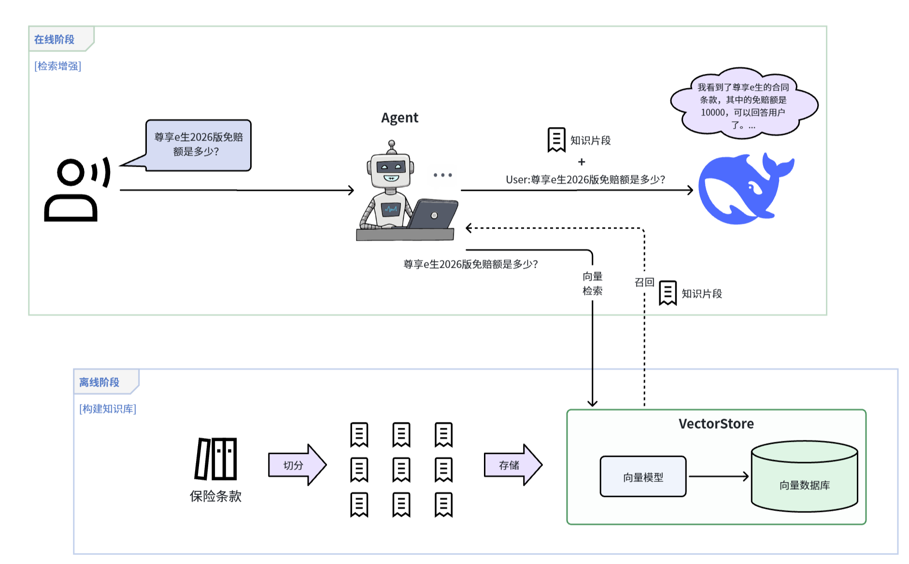
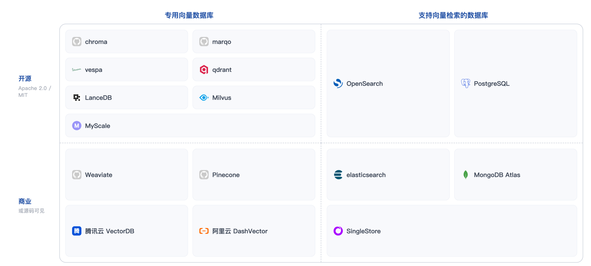

## 向量数据库-VectorStore

### 为什么要向量数据库？
向量数据库用于存储和检索向量化后的文档
- **存储**：向量 + 原文 + 元数据
- **检索**：构建高效的检索数据结构

### 向量数据库方法
LangChain提供了统一的 `VectorStore` 接口，使你可以用统一的方式调用任意向量库：
- `add_documents`: 添加文档到向量库（不用自己做文本向量化，只要提供好向量模型即可）
- `delete`: 根据id删除某个文档
- `similarity_search`: 基于相似度检索与用户问题有关的文档

 

也就是说，LangChain将`向量模型`与`向量数据库`进行封装
- 存储文档时，`VectorStore` 会自动把文档转向量，写入向量数据库
- 检索文档时，`VectorStore` 会自动把用户问题转向量，再去向量数据库搜索

### 常见向量数据库
LangChain支持多种向量库：

| 向量数据库               | 特点|适用场景|
|---------------------| --- | --- |
| `InMemoryVectorStore` | 内存存储，零配置 | 测试学习 |
| `Chroma`             | 轻量级，支持持久化 | 中小规模 |
| `FAISS`              | 高性能，支持GPU | 大规模检索 |
| `Milvus`              | 高性能，支持GPU | 大规模检索 |

其他常见向量数据库：

| 档位 | 数据库 | 核心特点 | 典型场景 | 部署形态 |
| :--- | :--- | :--- | :--- | :--- |
| **AI 原生档** AI-NATIVE | **Chroma** | 为 LLM 应用设计，API 简洁高效；内置持久化与元数据过滤；与 LangChain / LlamaIndex 深度集成，迭代活跃 | RAG 系统、智能体记忆、LLM 应用向量存储 | 嵌入式 / 云服务 |
| **扩展档** EXTENSION | **pgvector** | 复用 PostgreSQL 生态与事务能力，支持 HNSW / IVFFlat 索引 | 已有 PG 的业务系统，千万级以内向量 | 数据库扩展 |
| **扩展档** EXTENSION| **Elasticsearch** | 全文检索 + 向量混合查询能力强，生态成熟 | 企业搜索、日志分析、混合检索平台 | 独立集群 |
| **分布式档** DISTRIBUTED | **Milvus** | 云原生架构，支持十亿级向量，索引类型全面 | 大规模生产环境、高并发检索服务 | 独立集群 |
| **算法档** ALGORITHM | **FAISS** | Meta 出品，向量检索性能标杆，索引算法最全 | 作为检索引擎的底层算法组件 | 算法库 |

向量数据库市场格局：
