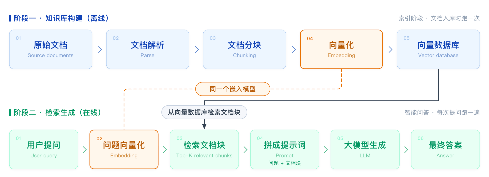

## RAG 基础认知

### 1. RAG是什么？
RAG（Retrieval-Augmented Generation），即检索增强生成
- **检索（Retrieval）**：从知识库中检索相关文档
- **增强（Augmented）**：将检索结果拼接到 Prompt 中，增强上下文
- **生成（Generation）**：大模型基于上下文生成回答

>RAG最早提出来是用来解决什么问题？     `实现多轮对话的记忆管理`

### 2. 为什么需要 RAG
主要是因为大模型本身存在以下局限性

| 问题 | 说明 | RAG 如何解决 |
| :--- | :--- | :--- |
| 幻觉 | 模型可能一本正经地编造事实 | 回答基于检索到的真实文档，有据可依 |
| 知识截止 | 模型训练数据有时间边界，无法知道最新信息 | 实时检索最新文档 |
| 知识限制 | 通用模型对企业/行业专有知识了解有限 | 接入企业私有知识库 |
| 数据隐私 | 敏感数据不能拿去训练模型 | 数据留在本地知识库，仅检索时调用 |
| 可追溯性差 | 模型回答无法标注来源 | 可以返回引用出处 |
| 更新成本高 | 微调/重新训练模型代价大 | 只需更新知识库，无需重新训练 |

### 3. RAG 完整流程
- 离线构建流程：文档清洗 -> 文档加载 -> 文档切块 -> 文档向量化 -> 向量数据库
- 在线查询流程：用户问题 -> 问题向量化 -> 向量检索 -> 拼接提示词 -> 答案生成

### 4. RAG 分类

### 5. RAG 适用场景

### 6. 向量检索技术
向量检索是判断文本语义相似度的方法
1. 利用**向量模型（Embedding）**将**文本**转换为**向量**
2. 通过计算**向量相似度**来判断语义相似度，向量越相似，语义越接近

向量相似度：①余弦相似度； ②欧式距离； ③点积
