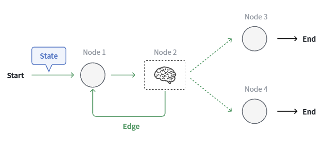

## LangGraph

### 1. AI 应用的发展过程

但是，Agent的自主控制能力与稳定程度之间是对立的两端，通常来说，LLM自主控制的越多，应用的稳定程度就会越小：

>LangGraph的作用就是在**保持Agent的自主控制程度不变的同时，提高Agent的稳定程度**

### 2. 认识 LangGraph
简单来说，LangGraph允许你自己定义Agent的**工作流（WorkFlow）**中的每一个**节点（Node）**：
- 需要稳定性的节点，就用传统编程控制
- 需要LLM自主控制的，就交给LLM

并且，整个工作流不再是一条直线运行的**链（Chain）**，而是一个像真正工作流那样有分支、有循环的**图（Graph）**。

在LangGraph中，工作流由3个基本的要素组成：
- **节点（Node）**：即工作流中的关键工作代码，可以是工具调用、知识检索、LLM调用
- **边（Edge）**：也可以理解为线，就是把各个节点连接起来的路径，是控制工作流走向的关键
- **状态（State）**：整个工作流中流转的数据

为了提高应用的运行的稳定程度，LangGraph为节点运行提供了Checkpointer功能，应用运行到每个**节点（Node）**都会形成**检查点（Checkpoint）**，我们可以方便的跳转到任意checkpoint，这样一来应用就具备了三大功能：
- **故障恢复**：即便是程序异常中止，也可以随时恢复到失败节点继续执行。
- **人机交互**：在程序运行中可以暂停工作流，在关键节点允许人工介入，得到人工确认后恢复执行，进一步提高程序的可靠性。
- **持久记忆**：由于Checkpointer可以持久化存储，能方便的拿到历史信息，因此应用还具备了记忆功能。

如果是**模型（Model）**是一匹能力卓越但跳脱的野马，那LangGraph就为你提供了一套控马的**鞍具（Harness）**，让模型在发挥自身智能的同时，还能被有效地控制。

正如LangChain官网所说，Agent = Model + Harness，有了LangGraph这套鞍具（Harness），才能让模型跑的又快又稳。