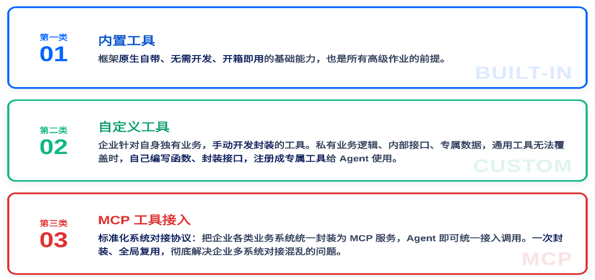
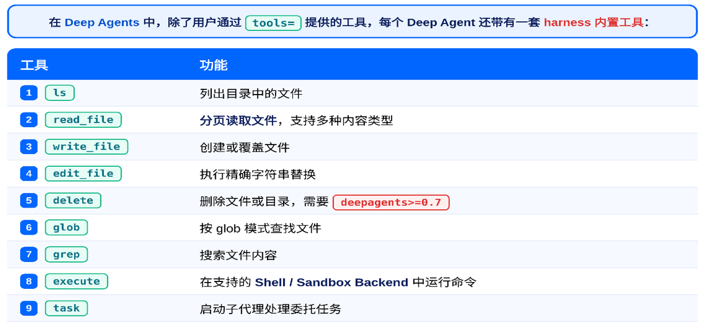
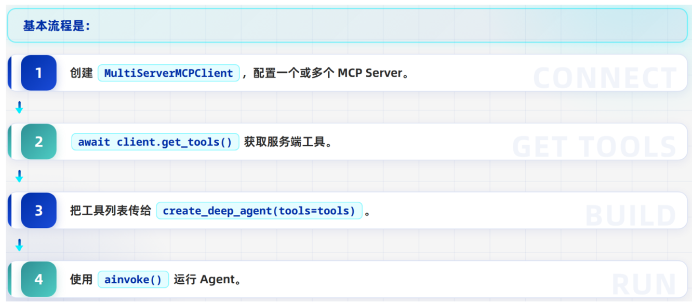
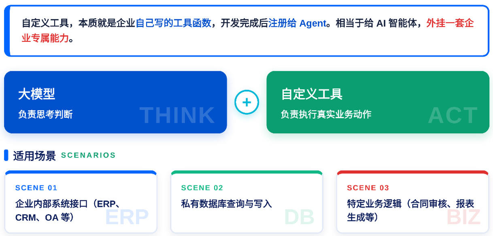
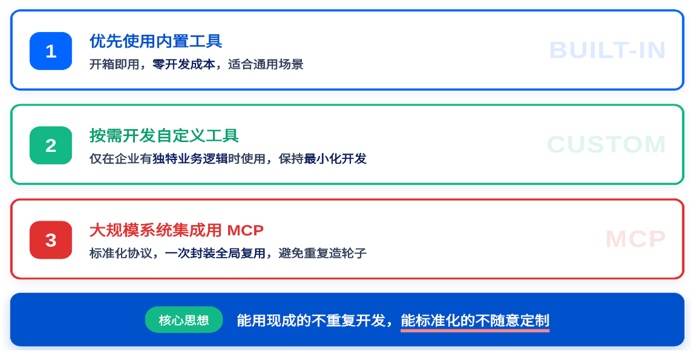

## 一、Deep Agents 架构三大工具体系

### 1.1 内置工具

| 类别 | 工具 | 作用 |
| :--- | :--- | :--- |
| 规划 | `write_todos` | 任务分解/待办 |
| 文件系统 | `ls` / `read_file` / `write_file` / `edit_file` / `glob` / `grep` | 读写虚拟文件系统 |
| 子代理 | `task` | 派发子代理 |

### 1.2 MCP工具接入实战

### 1.3 自定义工具

## 二、总结三类工具的落地原则

