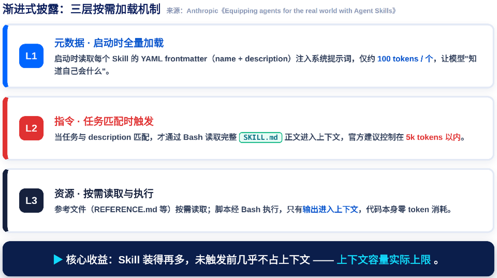

## 一、Skill是什么？
Deep Agents 里的 Skill 通常是一个**目录**，里面至少有一个 `Skill.md`，可选带 scripts、references、assets 等
```text
skill_name/
├── SKILL.md               # 必需：name + description
├── scripts/               # 可选、可执行脚本文件
├── references/            # 可选、按需参考材料与知识库
├── assets/                # 可选、模板、图片、字体等产出素材
└── ...                    # Any additional files or directories
```

Skill 是把某类任务的领域知识、固定流程、脚本打包，让 Agent 成为某个领域的专家

Agent + Skill = 领域专家

Skill = 指令能力（Prompt，Skill.md） + 工具能力（Tool） + 外部连接（MCP） + 企业治理

## 二、核心机制：渐进式披露 Progressive Disclosure
Agent 启动时智能看到 SKILL.md 中定义的 name + description，只有当用户任务命中 description 时，才会读取完整 SKILL.md，然后按需加载其余内容

```text
[初始状态] 仅读取 name + description
       ↓
[任务匹配] 用户任务命中 description
       ↓
[深度加载] 读取完整 SKILL.md
       ↓
[按需执行] 执行到特定步骤时，按需读取 references/ ，运行 scripts/，使用 assets/
```



## 三、Skill 撰写规范
https://agentskills.io/specification

## 四、何时使用 Skill
当**同一类复杂指令需要反复提供时**，应考虑将其封装为 Skill


| 适合的内容 | 例子 |
| --- | --- |
| **多步工作流** | 资料收集 --> 验证 --> 生成报告 |
| **领域知识** | 财务报表、法务模板、API 调用规则 |
| **可执行代码** | 数据转换、校验脚本、CLI 封装 |
| **指南和约束** | 输出格式、风格规范、必须运行测试 |
