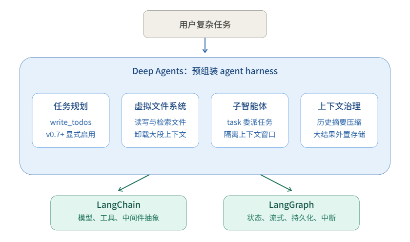

# Deep Agents
Deep Agents 的核心理念可以概括为一句话：

> 当任务复杂度超过单个 Agent 上下文窗口的承载能力时，用"显式规划"防止飘逸、用"子 Agent"隔离上下文、用"文件系统"卸载上下文

Deep Agents 的核心设计逻辑：能力可复用、风险可控制、技能可插拔、架构可扩展
- 业务技能层：Skills
- 安全管控层：文件权限、工具白名单、沙箱边界、人工介入（HITL）
- 底层能力层：工具能力、中间件、虚拟文件系统、LangGraph 运行时

> **LangGraph 运行时**：State、checkpoint、Store、中断恢复、流式输出都来自 LangGraph<br>
> **虚拟文件系统**：
> - `BackendProtocol` 定义了 `ls/read/write/edit/grep/glob` 七个方法
> - `backend`：实现 `BackendProtocol` 接口，提供文件系统功能
> **中间件**：
> - `TodoListMiddleware` → 提供 `write_todos`
> - `FilesystemMiddleware` → 提供文件工具 + 大结果自动驱逐
> - `SubAgentMiddleware` → 提供 `task` 派生能力
> - `SummarizationMiddleware` → 长对话摘要
> - `AnthropicPromptCachingMiddleware` → 提示缓存
> - `HumanInTheLoopMiddleware` → 审批中断

## 一、一句话理解
**Deep Agents = ReAct Agent + 显式规划 + 子代理委派 + 虚拟文件系统 + 上下文管理 + LangGraph 运行时**

普通 ReAct Agent 是：
```text
用户问题 -> 模型思考 -> 调工具 -> 观察 -> 再思考 -> ... -> 回答
```

Deep Agents 在这个循环外增加了一套“外骨骼”：
```text
主代理
 ├─ 规划：write_todos 维护任务清单
 ├─ 执行：调用工具，重试与回退
 ├─ 委派：task 启动子代理，子代理独立上下文
 ├─ 外存：虚拟文件系统管理中间结果和任务状态
 └─ 安全：沙箱执行、工具白名单/最小权限、HITL 审批
```



## 二、为什么要 Deep Agents
普通 ReAct Agent 在长任务中常见问题：

| 核心问题 | 表现 |
| :--- | :--- |
| **长任务容易跑偏** | 多步骤任务无全局计划，重复、遗漏、中断难恢复 |
| **上下文爆炸/遗忘** | 工具输出和中间结果塞满窗口，早期目标丢失 |
| **复杂子任务互相污染** | 单 Agent 串行处理，上下文混乱，不能并行 |
| **工具调用不可靠** | 选错工具、参数错、失败不重试、结果无校验 |
| **安全与成本失控** | 越权执行、难审计；全用大模型成本高 |


## 三、四大核心支柱
Deep Agents 最核心的是四个能力：

### ① File System：虚拟文件系统
#### 为什么需要虚拟文件系统？
传统智能体把所有中间结果都塞进上下文中，导致上下文爆炸，要么截断丢失信息，要么成本飙升

#### 虚拟文件系统有什么作用？
- 给智能体提供一套可以操作文件的工具（`ls/read/write/edit/grep/glob`），让它自己管理"工作区"
- 作用：
  - 中间结果落盘：大输出写文件，需要时再读/搜，不全部塞进上下文
  - 规划载体：用 `write_todos` 把待办列表存成文件，用 `read_file` 回看进度
  - 子智能体共享文件系统：父子智能体共享文件系统，实现"隔离上下文，共享产物"的委托模式
    - 父智能体把任务背景写入文件
    - 子智能体在隔离的上下文里工作，但可以 `read_file` 读取背景、`write_file` 写入结果
    - 子智能体完成后只把摘要返回给父智能体，完整产出留在文件里

#### 后端抽象（`BackendProtocol`）
| 后端 | 存储位置 | 生命周期 | 适用场景 |
| :--- | :--- | :--- | :--- |
| `StateBackend`（默认） | LangGraph agent state 内 | 单次线程/单次运行 | 默认，零配置，随对话结束而消失 |
| `StoreBackend` | LangGraph Store | 跨线程持久 | 多会话长期记忆、跨会话共享文件 |
| `FilesystemBackend` | 真实本地磁盘 | 持久 | 需要智能体操作真实项目文件 |
| `CompositeBackend` | 组合多个后端 | 路由 | 按路径前缀路由，如 `/memories/` 走 Store，其余走 State |

在 `StateBackend` 下，文件以 `TypedDict` 存在 agent state 的 `files` 字段里：
```text
class FileData(TypedDict):
    content: list[str]      # 按行拆分的列表
    created_at: str
    modified_at: str
```

#### 虚拟文件系统中间件：`FilesystemMiddleware`
上下文管理：把工具结果卸载到文件系统中
- 当单个工具返回结果的 token 数超过阈值时（配置项 `tool_token_limit_before_evict`，默认约 20,000 token）
- 中间件**自动把完整结果写入虚拟文件**（如 `/large_tool_results/<id>.txt`）
- 在对话上下文中，把原始结果**替换为一段引用**：告知模型"结果过大，已保存到 X 文件，请用 read_file/grep 查看相关部分

### ② Planning：显式任务规划
- 内置 todo/planning 工具，让主代理写任务清单、更新状态。
- 作用：任务分解、进度跟踪、防止长任务跑偏。
- 注意：todo 是“状态跟踪”，不是 DAG 工作流引擎；是否规划由模型自主决定。

### ③ Subagents：子代理
- 主代理通过 `task` 类工具把子任务委派给专用子代理。
- 子代理有独立提示、工具、模型和上下文。
- 子代理执行完通常只把摘要/结果返回主代理，避免污染主上下文。
- 适合：资料检索、代码审查、数据分析、专项调研。
- 原则：子代理要有清晰 `name`、`description`、`prompt`、工具边界；不是越多越好。

### ④ Detailed System Prompt：详细系统提示
- 内置提示会指导模型：何时规划、何时委派、如何使用文件、如何输出、何时停止。
- 自定义系统提示时，要保留这些行为规则，否则规划/子代理/文件能力可能用不好。

## 四、运行时与中间件架构
Deep Agents 通过 **middleware（中间件）** 把能力注入 Agent：
- Planning middleware：注入 todo 工具和规划提示。
- Filesystem middleware：注入文件工具和后端。
- Subagent middleware：注入 task 委派工具。
- Summarization middleware：长对话摘要，控制上下文。
- 可自定义中间件扩展工具调用、状态修改、提示注入、审批等。

底层是 LangGraph：
- invoke / stream 执行与流式输出。
- Checkpointer：持久化状态，支持恢复、thread_id。
- Store：长期记忆。
- Human-in-the-loop：可对高风险工具中断审批，例如写文件、执行命令。
- 支持部署、追踪、评估。

## 五、与 普通 Agent 的区别
| 维度 | 普通 ReAct Agent | Deep Agents |
| :--- | :--- | :--- |
| **任务长度** | 短到中等 | 长时程、多步骤 |
| **规划** | 隐式 | 显式 todo |
| **上下文** | 容易膨胀 | 文件卸载、摘要、子代理隔离 |
| **子任务** | 通常单代理 | 可委派子代理 |
| **记忆** | 主要靠消息 | 文件系统 + Store |
| **运行时** | 简单循环 | LangGraph 持久化、中断、流式 |
| **适用** | 简单工具调用 | 复杂开放式任务 |
